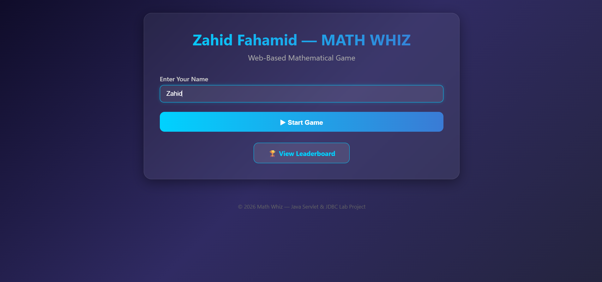
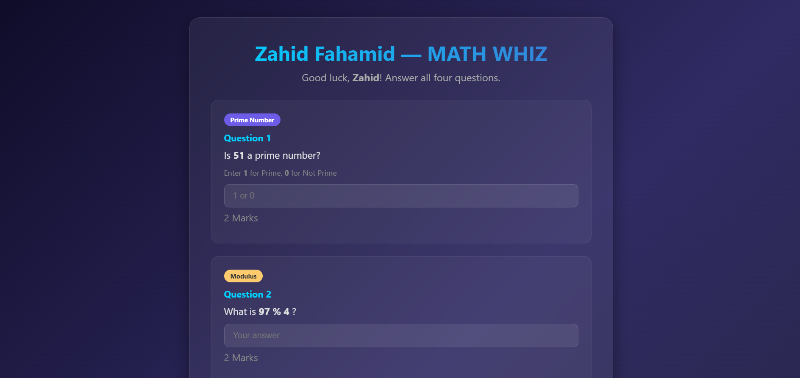
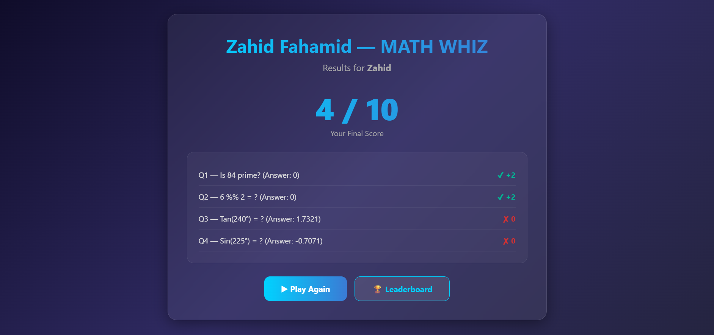
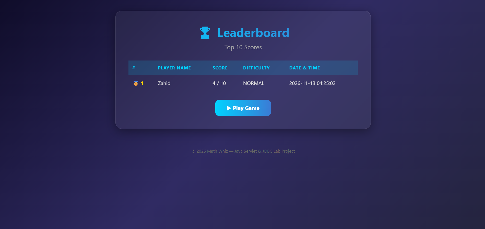

# Zahid Fahamid — MATH WHIZ

A web-based mathematical game built with **Java Servlets**, **JSP**, and **JDBC**. Players answer four mathematical questions (Prime Number, Modulus, and Trigonometry), earn scores out of 10, and compete on a live leaderboard.

---

## Project Objectives

- Develop reusable Java methods for mathematical calculations (prime check, modulus, trig functions).
- Apply server-side request/response processing with Java Servlets.
- Implement JDBC connectivity and database CRUD operations with `PreparedStatement`.
- Build a user-friendly multi-page web interface using JSP.
- Display a sorted Top 10 leaderboard from the database.

---

## Technologies Used

| Layer          | Technology                          |
|----------------|-------------------------------------|
| Language       | Java 11+                            |
| Web Framework  | Java Servlet 4.0 / JSP 2.3          |
| View           | JSP + JSTL                          |
| Database       | MySQL 8.x                           |
| DB Access      | JDBC with `PreparedStatement`        |
| Build Tool     | Apache Maven                        |
| Server         | Apache Tomcat 9.x                   |
| IDE            | IntelliJ IDEA / Eclipse / VS Code   |

---

## Software Requirements

- **JDK** 11 or later
- **Apache Maven** 3.6+
- **Apache Tomcat** 9.x
- **MySQL** 8.x (or MariaDB 10.x)
- A Java IDE (IntelliJ IDEA, Eclipse, or VS Code with Java extensions)

---

## Database Configuration

### 1. Create the Database and Table

Open a MySQL client and run the SQL script located at [`database/math_whiz_db.sql`](database/math_whiz_db.sql):

```sql
CREATE DATABASE IF NOT EXISTS math_whiz_db;

USE math_whiz_db;

CREATE TABLE IF NOT EXISTS game_scores (
    id INT PRIMARY KEY AUTO_INCREMENT,
    player_name VARCHAR(100) NOT NULL,
    score INT NOT NULL,
    difficulty VARCHAR(20) NOT NULL DEFAULT 'NORMAL',
    played_at TIMESTAMP DEFAULT CURRENT_TIMESTAMP
);
```

### 2. Configure JDBC Connection

Edit the connection constants in [`src/main/java/dao/ScoreDAO.java`](src/main/java/dao/ScoreDAO.java):

```java
private static final String DB_URL  = "jdbc:mysql://localhost:3306/math_whiz_db?useSSL=false&serverTimezone=UTC";
private static final String DB_USER = "root";
private static final String DB_PASS = "";   // ← set your MySQL password
```

---

## Steps to Run the Application

1. **Clone the repository**
   ```bash
   git clone https://github.com/username/repository.git
   cd repository/MathWhiz
   ```

2. **Set up the database**
   ```bash
   mysql -u root -p < database/math_whiz_db.sql
   ```

3. **Update JDBC credentials** in `ScoreDAO.java` (see above).

4. **Build the project**
   ```bash
   mvn clean package
   ```

5. **Deploy to Tomcat**
   - Copy `target/MathWhiz.war` into Tomcat's `webapps/` directory.
   - Start Tomcat.

6. **Open in browser**
   ```
   http://localhost:8080/MathWhiz/
   ```

---

## Game Rules & Scoring System

| Question | Mathematical Area                          | Marks |
|----------|--------------------------------------------|-------|
| Q1       | Prime Number (1 = Prime, 0 = Not Prime)    | 2     |
| Q2       | Modulus (integer operands only)             | 2     |
| Q3       | Trigonometric Value (Sin / Cos / Tan)       | 3     |
| Q4       | Trigonometric Value (Sin / Cos / Tan)       | 3     |
| **Total**|                                            | **10**|

### Important Rules

- **Prime**: Return `1` if the number is prime, `0` otherwise. Numbers less than 2 are not prime.
- **Modulus**: Accepts integers only. The divisor is never zero.
- **Trigonometry**: Accepts angles in degrees, converts to radians internally. Answers are compared using a tolerance of ±0.01.
- **Difficulty**: Currently `NORMAL` for all questions (stored in the database for future expansion).

---

## Project Structure

```
MathWhiz/
├── pom.xml
├── database/
│   └── math_whiz_db.sql
├── src/main/java/
│   ├── controller/
│   │   ├── GameServlet.java        # Handles start & submit actions
│   │   └── LeaderboardServlet.java # Retrieves top 10 scores
│   ├── model/
│   │   └── GameScore.java          # Game score entity
│   ├── service/
│   │   └── MathService.java        # isPrime, calculateMod, sin/cos/tan
│   └── dao/
│       └── ScoreDAO.java           # JDBC database operations
├── src/main/webapp/
│   ├── WEB-INF/web.xml
│   ├── index.jsp                   # Welcome / player name entry
│   ├── game.jsp                    # Four questions
│   ├── result.jsp                  # Score & answer breakdown
│   ├── leaderboard.jsp             # Top 10 leaderboard
│   └── css/style.css               # Application styles
├── screenshots/
│   ├── home.png
│   ├── game.png
│   ├── result.png
│   └── leaderboard.png
└── README.md
```

---

## Application Screenshots

### Welcome Page


### Game Page


### Result Page


### Leaderboard


---

## GitHub Project Directory Link

```
https://github.com/username/repository/tree/main/MathWhiz
```

---

## License

This project was developed as a lab assignment for Java Servlet & JDBC coursework.

